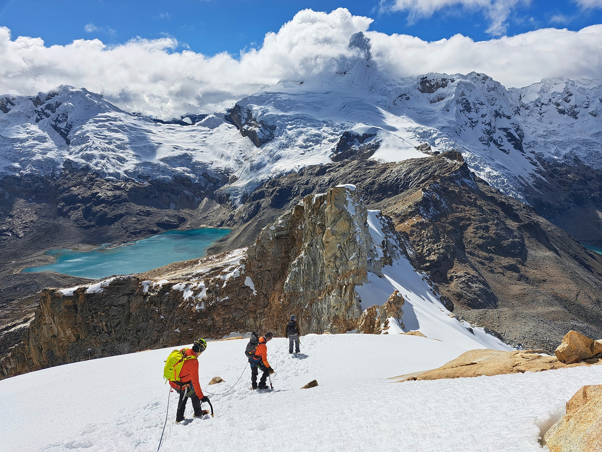

  

<h1 align="center">¡Hola! Soy Luis Bautista 👋</h1>

📊 Estadístico &nbsp;|&nbsp; 🤖 Ciencia de datos &nbsp;|&nbsp; 🧠 Machine learning &nbsp;|&nbsp; 🕸️ Deep learning

  

---

### 🚀 Sobre mí

🎓 Licenciado en Estadística (UNMSM) y Magíster en Estadística (PUCP); actualmente estudio Ingeniería de Sistemas.  
📚 Aprendo de forma continua y disfruto aplicar modelos estadísticos y de machine learning a problemas reales.  
🧪 Me gusta experimentar con técnicas nuevas, crear visualizaciones con impacto y construir soluciones con propósito.  
🌍 Busco desarrollar proyectos que apoyen la toma de decisiones basada en datos.

---

### 🔬 Portafolio QUANT SCIENTIST

Un sitio con experimentos estadísticos interactivos que se ejecutan en el navegador, construidos sobre una biblioteca estadística propia y probada:

| Experimento | Qué muestra |
|---|---|
| Teorema del límite central | Cómo cambia la forma de la media muestral con n, por simulación Monte Carlo |
| Inferencia bayesiana | Actualización Beta-Binomial exacta con intervalos creíbles |
| Evaluación de modelos | Por qué discriminación (ROC-AUC) y calibración no son lo mismo |
| Sobreajuste y validación cruzada | La curva en U del error y cómo la validación cruzada elige el modelo |
| Bootstrap | Intervalos por remuestreo y su cobertura real |
| Paradoja de Simpson | Cómo una variable de confusión puede invertir una tendencia |

🔗 [Ver el portafolio](https://lbautistab.github.io/quant-scientist-portfolio/) · 💻 [Código fuente](https://github.com/lbautistab/quant-scientist-portfolio)

---

### 🧠 Herramientas

---

### 📈 Áreas de interés

🔎 Análisis de datos y estadística aplicada  
📉 Modelamiento predictivo y machine learning  
🌐 Visualización de datos y storytelling  
🧠 Toma de decisiones basada en datos  
📊 Simulación estadística y modelamiento avanzado  

---

### 💡 Proyectos en los que he trabajado

📱 Aplicación en Flask para predecir especies de plantas  
🤖 Modelo de predicción de fuga de clientes (churn) para una empresa de telecomunicaciones  
📊 Dashboard educativo en Power BI para el seguimiento del rendimiento escolar  
📱 Aplicación en FastAPI para predecir el incumplimiento de pago de clientes  
🧪 Simulaciones estadísticas en Python y R para investigación académica  
🌄 Visualizaciones personales de rutas de montaña con datos GPS  

---

### ✨ Fuera de los datos

🏍️ Viajar largas distancias en moto  
🥾 Hacer trekking por senderos y paisajes remotos  
🧗‍♂️ Escalar montañas y nevados  
🚴‍♂️ Recorrer la ciudad y el campo en bicicleta  
🏋️‍♂️ Mantenerme activo en el gimnasio  

Aventura, disciplina y libertad son valores con los que vivo, ya sea en un sendero de montaña o en el mundo de los datos.

---

### 🌍 Conectemos

---

  Gracias por pasar por aquí 🙌 Siempre abierto a nuevas colaboraciones y desafíos.

